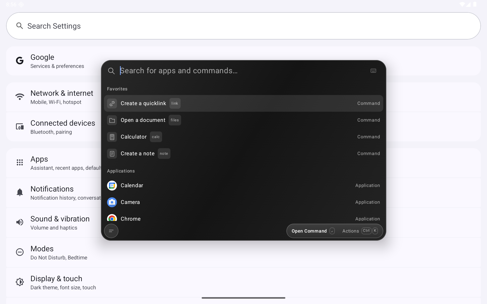

# DroidCast

An unofficial, native Android adaptation of [Tinycast](https://github.com/abue-ammar/tinycast), built with Kotlin and Jetpack Compose. Summon a compact floating search window over the app you are using, type, run a command, and dismiss it. The underlying app stays visible. The native overlay entry point was informed by [Launchpad Search](https://github.com/jaxparrow07/launchpad-search). The palette now ports the visual grammar of [Tinycast](https://github.com/abue-ammar/tinycast): its search header, section labels, neutral selection, compact rows, outlined keycaps, floating action capsule and two-column calculator card.


**0.4.0-preview** · Android 8.0+ · AGPL-3.0-or-later

[Download preview APK](https://github.com/moikdev/DroidCast/releases/tag/v0.4.0-preview) · [Parity audit](PARITY.md) · [Recommended improvements](ROADMAP.md) · [Testing record](docs/TESTING.md)

This preview covers the core palette workflow and a subset of Raycast extension APIs. **Window-snapping commands, automatic clipboard history, folder search, snippets and backup/import are not implemented.** See the parity matrix for the full scope. DroidCast is not affiliated with Tinycast's maintainers or Raycast.



## Build and install

Use JDK 17 or 21, Android SDK platform 36 and an Android 8.0+ device. Verification uses JDK 21 and an Android 16 tablet emulator.

Set `ANDROID_HOME`, or create `local.properties` with `sdk.dir=/path/to/Android/sdk`.

```sh
./gradlew :app:assembleDebug
adb install -r app/build/outputs/apk/debug/app-debug.apk
```

The Gradle wrapper and distribution checksum are included. JDK 21 is the verified toolchain. The installed package remains `dev.tinycast.android` so earlier previews can be upgraded. The app label and public project name are DroidCast.

The downloadable APK is a debug-signed preview, not a production-signed release. CI debug APKs can use a different signing certificate. Uninstalling removes local collections; backup/export is not implemented yet.

## The palette

- Translucent activity with Tinycast’s 750×475 tablet proportions and 26 dp corners, adapted to smaller screens. A single search header, Favorites and category sections, compact 44 dp rows, native app icons and a contextual action capsule. No draw-over-other-apps permission.
- Neutral dark surfaces follow Tinycast’s white-alpha color tokens. Android uses its own fonts and a neutral gradient surface; macOS Liquid Glass is not reproduced.
- The circular bottom-left menu opens category filters, Preferences, shortcuts and dismissal. Actions appear in an anchored menu above the bottom-right capsule; Ctrl+K and long-press open the same menu. Calculator answers use source → result columns with unit badges.
- The area outside the palette is fully transparent, with no dark scrim or screen dimming.
- Tap outside or close to return to the previous app. App and URL commands dismiss the palette when launching their destination.
- Summon using the app icon, Android assistant intent, the optional DroidCast search Quick Settings tile, or Ctrl + Space after explicitly enabling the keyboard service.
- Fuzzy app/command search, aliases, pins and usage ranking.
- Prefixes: `@` apps, `#` notes, `:` quicklinks, `>` built-in commands, `=` calculator.
- Local calculator and conversions: `200 * 15%`, `sqrt(81)`, `10 km to mi`, `32 f to c`, `1.5 h to min`, `1 gib to mib`. Trigonometric inputs use radians. No currency rates.
- Persistent plain-text/Markdown notes, custom HTTP/HTTPS quicklinks with `{query}` arguments, saved clips and shared/selected-text input.
- Android document picker, persistent URI grants where supported, and searchable recent files. This does not index the device filesystem.

## Raycast Store extensions

Run **Raycast Store** (alias `store`) to browse, search and install the Store's real prebuilt bundles. The Installed tab lists commands, updates from Store, and uninstallation. Installed commands also appear in palette search and the Extensions filter. Installation alone does not run a command.

The installer refreshes the exact Store entry before downloading because download URLs expire. It validates ZIP paths, size limits, package identity and built command files; updates replace an existing installation only after validation. The Store endpoints are the same public, unofficial endpoints used by upstream Tinycast and may change.

The upstream Tinycast JavaScript runtime is bundled unchanged, including its React reconciler and Raycast API shims. Android supplies a host bridge and native Compose views. A restricted, non-navigating WebView runs JavaScript; it does not render the extension UI or load remote pages. Each foreground command owns a runtime, which is destroyed when you leave it.

Supported Android host capabilities:

- `List`, `Grid` as a native list, searchable items, selection, native actions and navigation.
- `Detail` as selectable text/Markdown source.
- Basic `Form` text/password/text-area, checkbox and dropdown fields, descriptions, separators and submit actions.
- Manifest arguments and preferences, including defaults and required fields.
- Foreground clipboard copy/read, isolated LocalStorage and cache, timers, HTTPS fetch and ordinary web URLs.
- Secure random bytes/UUIDs and common hashes. Read-only package assets and limited filesystem access within the extension's own data folder.

**Compatibility is partial.** Installing successfully does not imply every command works. Shell/process execution, AppleScript, Mac apps, desktop helpers, OAuth, menu bars, WebSockets, browser/window-management APIs and Raycast AI services are unsupported. Unsupported host calls report an error. Clipboard paste into other apps is unavailable; use Copy. Advanced form controls and full Markdown rendering remain incomplete.

Real Store packages tested include UUID Generator (generation, clipboard, native history) and OKLCH Color Converter (Store UI installation, reactive native results and copy actions). This is not an ecosystem-wide compatibility claim.

Store searches/downloads contact Raycast. Running third-party code can make HTTPS requests and access the foreground clipboard; an install confirmation explains this. Extension storage and preferences are scoped per extension and excluded from OS backup. Uninstall removes the extension and its own data.

## Keyboard

| Shortcut | Action |
| --- | --- |
| Ctrl + Space | Summon globally, after optional service setup |
| Ctrl + L | Focus search/show keyboard |
| Up / Down, Enter | Select and run |
| Ctrl + K | Actions |
| Ctrl + D | Pin/unpin selected command |
| Ctrl + N | New note |
| Ctrl + 1…8 | All, Pinned, Apps, Notes, Quicklinks, Clips, Files, Extensions |
| Ctrl + S / Ctrl + Enter | Save editor |
| Escape | Close dialog, clear search/back, then dismiss palette |

Enable the global shortcut through Preferences → Open accessibility settings → DroidCast keyboard shortcut. The service does not retrieve screen content or record keystrokes. In-app shortcuts do not require it. Global key delivery can vary with other accessibility services and OEM shortcuts.

## Verify

```sh
./gradlew :app:testDebugUnitTest :app:lintDebug :app:assembleDebug :app:assembleDebugAndroidTest
adb install -r app/build/outputs/apk/debug/app-debug.apk
adb install -r app/build/outputs/apk/androidTest/debug/app-debug-androidTest.apk
adb push test-fixtures/document.png /sdcard/Download/tinycast-test-image.png
adb shell am instrument -w -r dev.tinycast.android.test/androidx.test.runner.AndroidJUnitRunner
```

The Store tests require internet access and intentionally install/run public Store packages. The tests cover real bundles rather than locally substituted commands. The file test requires the PNG fixture. Named note/clip fixtures are cleaned up. The color extension is left installed for inspection.

Global shortcut testing runs outside UiAutomation because UI instrumentation can suppress accessibility services:

```sh
python3 scripts/test-global-shortcut.py --serial emulator-5580
# Ten rounds from Settings and Home (20 global shortcut activations):
python3 scripts/test-global-shortcut.py --serial emulator-5580 --rounds 10
adb -s emulator-5580 unroot
```

That helper is restricted to the dedicated `Tinycast_Tablet_API_36` emulator. Root adbd is used only to inject hardware-style Linux key events; the app stays unprivileged and does not require root.

## Extended workflow test

`EnduranceDeviceTest` is opt-in; ordinary test runs skip it. It repeatedly opens Settings through both the built-in command and installed-app search, copies calculated answers, uses the Actions menu, opens image/PDF documents and rotates the display. It also opens a text file through Android’s viewer chooser and verifies its saved read grant and contents. Use at least five minutes; the test also requires at least 20 rounds.

```sh
adb push test-fixtures/document.png /sdcard/Download/tinycast-test-image.png
adb push test-fixtures/document.pdf /sdcard/Download/tinycast-soak-document.pdf
adb push test-fixtures/document.txt /sdcard/Download/tinycast-soak-document.txt
adb shell am instrument -w -r -e class dev.tinycast.android.EnduranceDeviceTest -e runSoak true -e durationSeconds 300 dev.tinycast.android.test/androidx.test.runner.AndroidJUnitRunner
mkdir -p artifacts
adb exec-out run-as dev.tinycast.android tar -C files -cf - extended-test > artifacts/endurance-device-evidence.tar
```

After a successful endurance run, `python3 scripts/test-restart-files.py --serial emulator-5580` force-stops both Tinycast and each viewer, then reopens all three recent documents.

The image test expects Google Photos, the PDF test expects Google's PDF viewer, and the text test selects the built-in HTML Viewer through Android’s chooser, matching the dedicated AVD. Evidence is written to the app's `files/extended-test/` folder. Do not operate the emulator during automation. Native Android split-screen and divider resizing can be used around the palette; Tinycast does not yet provide commands that snap other apps into windows.

## CI template

A pinned, lint-checked workflow is provided in [`ci/android.yml`](ci/android.yml). It is not active: the publishing credential can create repositories and push source, but lacks GitHub’s `workflow` scope. See [`ci/README.md`](ci/README.md) to enable it with an authorized credential. Local build, unit, lint and device checks are documented in [docs/TESTING.md](docs/TESTING.md).

## What to improve next

The highest-value next steps are verified extension compatibility and richer native views, user-controlled backup/restore, configurable command hotkeys, direct Android settings/intent commands, selected-folder search and supported multitasking actions. These are proposals, not advertised preview features. [ROADMAP.md](ROADMAP.md) gives priorities and acceptance criteria; [PARITY.md](PARITY.md) compares the current implementation with upstream.

## Source and attribution

- `PaletteTheme.kt`, `PaletteUi.kt`: adapted Tinycast design tokens, floating palette, grouped rows, calculator card and keyboard controls.
- `third_party/tinycast-palette/`: unchanged Swift reference sources and exact commit provenance for the visual port, licensed AGPL-3.0.
- `CommandEngine.kt`, `PaletteStore.kt`: search, calculation, persistence and command dispatch.
- `MainActivity.kt`, `PaletteTileService.kt`: Android entry points, intents, file grants and shortcut service.
- `extensions/ExtensionCatalog.kt`: Store networking, archive validation, install/update/uninstall and manifest state.
- `extensions/ExtensionRuntime.kt`, `assets/android-runtime.js`: Android host and JavaScript engine adapter.
- `extensions/ExtensionUi.kt`: native Store, preferences and extension rendering.
- `third_party/tinycast-runtime/`: upstream source, build files, license and exact commit provenance. The generated runtime asset is copied unchanged. Store extensions are downloaded at runtime under their respective licenses, not bundled into this APK.

Project license: AGPL-3.0-or-later. See [LICENSE](LICENSE) and [NOTICE.md](NOTICE.md) for upstream attribution and modification notices. No analytics or account is required. AI commands and background clipboard monitoring are not included.
